  
  

*The diagram above is generated from [`config/cradio.keymap`](config/cradio.keymap) with [keymap-drawer](https://github.com/caksoylar/keymap-drawer).*
*Run `./scripts/gen-layout.sh` after changing the keymap and commit the regenerated files.*
